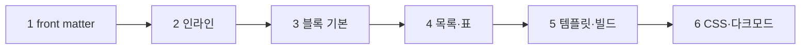

# my-blog Implementation Plan

> **For agentic workers:** REQUIRED SUB-SKILL: Use superpowers:subagent-driven-development (recommended) or superpowers:executing-plans to implement this plan task-by-task. Steps use checkbox (`- [ ]`) syntax for tracking.

**Goal:** `posts/*.md`를 다크 모드·모바일 대응 정적 HTML 블로그(`dist/`)로 변환하는 무의존성 빌더.

**Architecture:** `build.js` 한 파일에 front matter 파서 · Markdown 렌더러 · 템플릿 · 빌드 함수. 모든 함수는 `module.exports`로 내보내고, 직접 실행 시에만 빌드. 스타일·토글은 `static/`에 두고 빌드 때 `dist/static/`으로 복사.

**Tech Stack:** Node v26 (`node:fs`, `node:path`, `node:os`, `node:test`, `node:assert/strict`), 순수 CSS, 순수 브라우저 JS. CommonJS.

**Spec:** [CLAUDE.md](../../CLAUDE.md)

> git 저장소 아님 → 커밋 단계 없음. 필요하면 시작 전 `git init` 후 태스크마다 커밋.

## Global Constraints

- `node:*` 모듈만 사용. npm 패키지·CDN 라이브러리·`package.json` 금지
- 필수 front matter: `date`(`YYYY-MM-DD`) · `title`. 누락·형식 오류 → 파일명 포함 에러로 종료
- 그 외 front matter 키는 무시
- 파일명 `YYYY-MM-DD-slug.md` → `dist/posts/slug.html`
- `draft: true` → 빌드 제외
- 원본 HTML·미지원 문법 → escape된 원문으로 출력
- 링크·이미지의 `javascript:` 등 위험 URL 차단
- `dist/`는 매번 전체 재생성. 직접 편집 금지
- 기존 `posts/` 파일 수정 금지 (샘플 글 신규 생성만 허용)
- 본문 `max-width: 68ch`, `font-size: clamp(16px, 1rem + 0.25vw, 18px)`, `line-height: 1.75`
- 폰트: `-apple-system, "Apple SD Gothic Neo", "Noto Sans KR", sans-serif` (웹폰트 없음)
- 색 대비 WCAG AA (본문 4.5:1)
- 색 변수: `--bg` `--fg` `--muted` `--accent` `--code-bg` `--border`
- 다크 모드: 기본 `prefers-color-scheme`, 토글 → `<html data-theme>` + `localStorage`, `<head>` 인라인 스크립트로 깜빡임 방지
- 모바일: viewport meta, 좌우 여백 ≥ 16px, 가로 스크롤 없음, `img { max-width: 100% }`, 코드·표 `overflow-x: auto`, 터치 대상 ≥ 44px
- `<html lang="ko">`, `header`/`main`/`article`/`time datetime`, `:focus-visible` 유지

## Review Focus

1. CRLF·BOM 섞인 md (Windows·일부 에디터 저장) → 일반 파일과 같게 파싱 → Task 1 `parsePost: CRLF·BOM`
2. 글 하나가 깨진 상태로 빌드 → 에러 종료 + 기존 `dist/` 보존 (사이트 통째 삭제 방지) → Task 5 `build: 잘못된 글이면 기존 dist 보존`
3. 한글 파일명 (`2026-11-09-첫글.md`) → 파일 생성 + 링크 URL 인코딩 → Task 5 `build: 글·목록·static 생성`
4. 닫히지 않은 코드 펜스 → 이후 내용 유실·크래시 없이 끝까지 코드 → Task 3 `닫히지 않은 펜스`
5. 제목 값 안의 콜론 (`title: 회고: 2026`) → 첫 `: `에서만 분리 → Task 1 `값 안의 콜론 유지`

## 파일 맵

```
my-blog/
├── build.js                    # Task 1~5
├── build.test.js               # Task 1~5
├── posts/2026-11-09-hello.md   # Task 5 (샘플, 전 문법 포함)
└── static/
    ├── style.css               # Task 6
    └── theme.js                # Task 6
```

## 진행 순서



---

### Task 1: 뼈대 + escape + front matter 파서

**Files:**
- Create: `build.js`, `build.test.js`

**Interfaces:**
- Produces:
  - `escapeHtml(s: string): string` — `& < > " '` → `&amp; &lt; &gt; &quot; &#39;`
  - `parseFrontMatter(src: string): { data: object, body: string }` — 입력은 `\n` 줄바꿈 가정
  - `parsePost(src: string, filename: string): Post`
  - `Post = { filename, slug, date, title, tags: string[], description: string, draft: boolean, body: string }`

- [ ] **Step 1: 실패 테스트 작성** (`build.test.js` 상단에 공통 import)

```js
const test = require('node:test');
const assert = require('node:assert/strict');
const b = require('./build.js');

test('escapeHtml', () => {
  assert.equal(b.escapeHtml(`<a href="x">'&'</a>`),
    '&lt;a href=&quot;x&quot;&gt;&#39;&amp;&#39;&lt;/a&gt;');
});

test('parseFrontMatter: 문자열·배열·불리언·따옴표', () => {
  const { data, body } = b.parseFrontMatter('---\ntitle: "안녕"\ntags: [a, b]\ndraft: true\n---\n본문');
  assert.deepEqual(data, { title: '안녕', tags: ['a', 'b'], draft: true });
  assert.equal(body, '본문');
});

test('parseFrontMatter: 값 안의 콜론 유지', () => {
  assert.equal(b.parseFrontMatter('---\ntitle: 회고: 2026\n---\n').data.title, '회고: 2026');
});

test('parseFrontMatter: front matter 없으면 빈 data', () => {
  assert.deepEqual(b.parseFrontMatter('그냥 본문'), { data: {}, body: '그냥 본문' });
});

test('parsePost: CRLF·BOM 정규화, slug·기본값', () => {
  const p = b.parsePost('\uFEFF---\r\ndate: 2026-11-09\r\ntitle: 첫 글\r\ntags: blog\r\n---\r\n본문\r\n', '2026-11-09-첫글.md');
  assert.equal(p.slug, '첫글');
  assert.equal(p.date, '2026-11-09');
  assert.equal(p.title, '첫 글');
  assert.deepEqual(p.tags, ['blog']);
  assert.equal(p.description, '');
  assert.equal(p.draft, false);
  assert.equal(p.body, '본문\n');
  assert.equal(p.filename, '2026-11-09-첫글.md');
});

test('parsePost: 필수값 누락·잘못된 날짜 → 파일명 포함 에러', () => {
  assert.throws(() => b.parsePost('---\ndate: 2026-11-09\n---\n', 'a.md'), /a\.md: title/);
  assert.throws(() => b.parsePost('---\ntitle: t\n---\n', 'b.md'), /b\.md: date/);
  assert.throws(() => b.parsePost('---\ntitle: t\ndate: 2026-02-30\n---\n', 'c.md'), /c\.md: date/);
});
```

- [ ] **Step 2: 실패 확인**

Run: `node build.test.js`
Expected: FAIL — `Cannot find module './build.js'`

- [ ] **Step 3: `build.js`에 3개 함수 구현 + `module.exports`**

- `parseFrontMatter`: 첫 줄 `---` ~ 다음 `---` 사이를 줄 단위로. 첫 `: `에서 분리. `[a, b]` → 배열, `true`/`false` → 불리언, 앞뒤 `"`/`'` 제거
- `parsePost`: BOM 제거 + `\r\n` → `\n` 후 `parseFrontMatter`. slug = 파일명에서 `.md`와 `^\d{4}-\d{2}-\d{2}-` 제거. `tags`가 문자열이면 `[값]`
- 날짜 검증: `/^\d{4}-\d{2}-\d{2}$/` + `new Date(date + 'T00:00:00Z')`가 Invalid Date 아님(`toISOString()`은 Invalid Date에서 throw) + `.toISOString().slice(0, 10) === date`
- 에러 메시지 형식: `` `${filename}: title 누락` `` / `` `${filename}: date 형식 오류 (YYYY-MM-DD)` ``

- [ ] **Step 4: 통과 확인**

Run: `node build.test.js`
Expected: PASS 6/6

---

### Task 2: 인라인 렌더러 + URL 안전 처리

**Files:**
- Modify: `build.js`, `build.test.js`

**Interfaces:**
- Consumes: `escapeHtml`
- Produces:
  - `safeUrl(url: string): string` — 위험 스킴이면 `'#'`
  - `renderInline(text: string): string` — 원본 md 한 줄 → HTML

- [ ] **Step 1: 실패 테스트 작성**

```js
test('renderInline: 강조·코드·링크·이미지', () => {
  assert.equal(b.renderInline('**굵게** *기울임* `x`'), '<strong>굵게</strong> <em>기울임</em> <code>x</code>');
  assert.equal(b.renderInline('[글](https://a.com/?q=1&r=2)'), '<a href="https://a.com/?q=1&amp;r=2">글</a>');
  assert.equal(b.renderInline(''), '');
});

test('renderInline: 코드 안은 escape만, 서식 미적용', () => {
  assert.equal(b.renderInline('`<script>**x**</script>`'), '<code>&lt;script&gt;**x**&lt;/script&gt;</code>');
});

test('renderInline: 원본 HTML은 escape', () => {
  assert.equal(b.renderInline('<b>hi</b>'), '&lt;b&gt;hi&lt;/b&gt;');
});

test('safeUrl: 위험 스킴 차단, 일반 URL 통과', () => {
  for (const u of ['javascript:alert(1)', ' JavaScript:alert(1)', 'java\tscript:alert(1)', 'data:text/html,x', 'vbscript:x'])
    assert.equal(b.safeUrl(u), '#', u);
  for (const u of ['https://a.com', 'http://a.com', 'mailto:a@b.c', '../img/a.png', '/x', '#top', 'cat.png'])
    assert.equal(b.safeUrl(u), u, u);
  assert.equal(b.renderInline('[x](javascript:alert)'), '<a href="#">x</a>');
});
```

- [ ] **Step 2: 실패 확인**

Run: `node build.test.js`
Expected: FAIL — `b.renderInline is not a function`

- [ ] **Step 3: 구현**

- `safeUrl`: 공백·제어문자(`/[\s\u0000-\u001f]/g`) 제거본으로 판정. `/^[a-z][a-z0-9+.-]*:/i` 매치 & `http:`/`https:`/`mailto:` 아님 → `'#'`. 통과 시 원래 값 반환
- `renderInline`: 전체 `escapeHtml` → `` /(`[^`]+`)/ ``로 split → 코드 조각은 `<code>`만, 나머지에 이미지 → 링크 → `**` → `*` 순서로 치환. href/src는 `safeUrl` 통과

- [ ] **Step 4: 통과 확인**

Run: `node build.test.js`
Expected: PASS 10/10

---

### Task 3: 블록 렌더러 — 제목·문단·코드 펜스·구분선·인용

**Files:**
- Modify: `build.js`, `build.test.js`

**Interfaces:**
- Consumes: `escapeHtml`, `renderInline`
- Produces: `renderMarkdown(md: string): string` — 블록들을 `'\n'`으로 연결

- [ ] **Step 1: 실패 테스트 작성**

```js
test('renderMarkdown: 제목·문단·줄바꿈·구분선', () => {
  assert.equal(b.renderMarkdown('# 제목\n\n첫 줄  \n둘째 줄\n셋째\n\n---'),
    '<h1>제목</h1>\n<p>첫 줄<br>\n둘째 줄\n셋째</p>\n<hr>');
});

test('renderMarkdown: 코드 펜스는 escape만·언어 클래스', () => {
  assert.equal(b.renderMarkdown('```js\nconst a = 1 < 2; // **x**\n```'),
    '<pre><code class="language-js">const a = 1 &lt; 2; // **x**</code></pre>');
});

test('renderMarkdown: 닫히지 않은 펜스는 끝까지 코드', () => {
  assert.equal(b.renderMarkdown('```\na\n\n# b'), '<pre><code>a\n\n# b</code></pre>');
});

test('renderMarkdown: 인용은 내부를 재귀 렌더', () => {
  assert.equal(b.renderMarkdown('> **중요**\n> 둘째'),
    '<blockquote>\n<p><strong>중요</strong>\n둘째</p>\n</blockquote>');
});
```

- [ ] **Step 2: 실패 확인**

Run: `node build.test.js`
Expected: FAIL — `b.renderMarkdown is not a function`

- [ ] **Step 3: 구현**

- 줄 단위 상태 머신. 판정 순서: 펜스 → 제목(`#{1,6} `) → `---`만 있는 줄 → `>` → 빈 줄 → 문단
- 문단: 다음 빈 줄·블록 시작까지. 끝이 공백 2개 이상인 줄 → `<br>`
- 언어 클래스: `/^[\w-]+$/` 통과할 때만 붙임
- 인용: 각 줄 앞 `> ` 또는 `>` 제거 → `renderMarkdown` 재귀 → `<blockquote>\n…\n</blockquote>`

- [ ] **Step 4: 통과 확인**

Run: `node build.test.js`
Expected: PASS 14/14

---

### Task 4: 블록 렌더러 — 목록·표

**Files:**
- Modify: `build.js`, `build.test.js`

**Interfaces:**
- Consumes/Produces: `renderMarkdown` 확장 (시그니처 동일)

- [ ] **Step 1: 실패 테스트 작성**

```js
const norm = s => s.replace(/\n/g, '');

test('renderMarkdown: ul·ol, 2단계 중첩, 3단계 이상은 2단계로 평탄화', () => {
  assert.equal(norm(b.renderMarkdown('- a\n  - a1\n    - a2\n- **b**\n\n1. x\n2. y')),
    '<ul><li>a<ul><li>a1</li><li>a2</li></ul></li><li><strong>b</strong></li></ul><ol><li>x</li><li>y</li></ol>');
});

test('renderMarkdown: 표 → 스크롤 래퍼, 셀 인라인 렌더, 정렬 표기 무시', () => {
  assert.equal(norm(b.renderMarkdown('| 이름 | 값 |\n|---|---:|\n| `a` | 1 |')),
    '<div class="table-wrap"><table><thead><tr><th>이름</th><th>값</th></tr></thead>' +
    '<tbody><tr><td><code>a</code></td><td>1</td></tr></tbody></table></div>');
});

test('renderMarkdown: 구분 줄 없는 | 줄은 문단', () => {
  assert.equal(b.renderMarkdown('| 그냥 |'), '<p>| 그냥 |</p>');
});
```

- [ ] **Step 2: 실패 확인**

Run: `node build.test.js`
Expected: FAIL — 목록·표 테스트 3개

- [ ] **Step 3: 구현**

- 목록 항목: `^(\s*)(-|\d+\.) `. 들여쓰기 0 → 1단계, 2칸 이상 → 2단계
- 표 시작: `|`로 시작하는 줄 + 다음 줄이 `/^\|?\s*:?-+:?\s*(\|\s*:?-+:?\s*)*\|?\s*$/`
- 셀: 앞뒤 `|` 제거 후 `|`로 split, trim, `renderInline`

- [ ] **Step 4: 통과 확인**

Run: `node build.test.js`
Expected: PASS 17/17

---

### Task 5: 템플릿 + 빌드 + 샘플 글

**Files:**
- Modify: `build.js`, `build.test.js`
- Create: `posts/2026-11-09-hello.md`

**Interfaces:**
- Consumes: `parsePost`, `renderMarkdown`, `escapeHtml`
- Produces:
  - `SITE_TITLE = 'my-blog'`
  - `layout({ title, description, body, root }): string` — `root`는 `''`(목록) 또는 `'../'`(글)
  - `renderIndex(posts: Post[]): string`
  - `renderPostPage(post: Post): string`
  - `build({ srcDir, outDir, staticDir } = {}): { count: number }` — 기본값은 `__dirname` 기준 `posts`/`dist`/`static`
  - Task 6용 마크업: `<button class="theme-toggle" type="button" aria-label="다크 모드 전환" aria-pressed="false">◐</button>`

- [ ] **Step 1: 실패 테스트 작성**

```js
const fs = require('node:fs');
const path = require('node:path');
const os = require('node:os');

function makeSite(posts) {
  const dir = fs.mkdtempSync(path.join(os.tmpdir(), 'blog-'));
  fs.mkdirSync(path.join(dir, 'posts'));
  fs.mkdirSync(path.join(dir, 'static'));
  fs.writeFileSync(path.join(dir, 'static', 'style.css'), '');
  for (const [name, src] of Object.entries(posts)) fs.writeFileSync(path.join(dir, 'posts', name), src);
  return dir;
}
const opts = dir => ({ srcDir: path.join(dir, 'posts'), outDir: path.join(dir, 'dist'), staticDir: path.join(dir, 'static') });
const post = (date, title, extra = '') => `---\ndate: ${date}\ntitle: ${title}\n${extra}---\n본문`;
const read = (dir, f) => fs.readFileSync(path.join(dir, 'dist', f), 'utf8');

test('layout: 공통 요소·escape', () => {
  const html = b.layout({ title: 'T<', description: 'D"', body: '<p>x</p>', root: '../' });
  for (const s of ['<html lang="ko">', 'name="viewport"', '<title>T&lt;', 'content="D&quot;"',
    'href="../static/style.css"', 'src="../static/theme.js"', 'class="theme-toggle"',
    "localStorage.getItem('theme')", '<main>'])
    assert.ok(html.includes(s), s);
});

test('build: 글·목록·static 생성, 최신순, draft 제외', () => {
  const dir = makeSite({
    '2026-01-01-old.md': post('2026-01-01', '옛 글'),
    '2026-11-09-첫글.md': post('2026-11-09', '새 글'),
    '2026-11-10-wip.md': post('2026-11-10', '초안', 'draft: true\n'),
  });
  assert.equal(b.build(opts(dir)).count, 2);
  const index = read(dir, 'index.html');
  assert.ok(index.indexOf('새 글') < index.indexOf('옛 글'));
  assert.ok(!index.includes('초안'));
  assert.ok(index.includes(`href="posts/${encodeURIComponent('첫글')}.html"`));
  assert.ok(read(dir, 'posts/첫글.html').includes('<time datetime="2026-11-09">'));
  assert.ok(!fs.existsSync(path.join(dir, 'dist/posts/wip.html')));
  assert.ok(fs.existsSync(path.join(dir, 'dist/static/style.css')));
});

test('build: 이전 빌드 잔여 파일 제거', () => {
  const dir = makeSite({ '2026-11-09-a.md': post('2026-11-09', 'A') });
  fs.mkdirSync(path.join(dir, 'dist/posts'), { recursive: true });
  fs.writeFileSync(path.join(dir, 'dist/posts/stale.html'), '');
  b.build(opts(dir));
  assert.ok(!fs.existsSync(path.join(dir, 'dist/posts/stale.html')));
});

test('build: 잘못된 글이면 기존 dist 보존', () => {
  const dir = makeSite({ '2026-11-09-a.md': post('2026-11-09', 'A') });
  b.build(opts(dir));
  fs.writeFileSync(path.join(dir, 'posts', 'broken.md'), '---\ntitle: x\n---\n');
  assert.throws(() => b.build(opts(dir)), /broken\.md: date/);
  assert.ok(fs.existsSync(path.join(dir, 'dist/posts/a.html')));
});

test('build: slug 중복 → 두 파일명 포함 에러', () => {
  const dir = makeSite({ '2026-01-01-a.md': post('2026-01-01', 'A'), '2026-02-01-a.md': post('2026-02-01', 'B') });
  assert.throws(() => b.build(opts(dir)),
    e => e.message.includes('2026-01-01-a.md') && e.message.includes('2026-02-01-a.md'));
});

test('build: 글 0개면 빈 목록 안내', () => {
  const dir = makeSite({});
  b.build(opts(dir));
  assert.match(read(dir, 'index.html'), /아직 글이 없습니다/);
});
```

- [ ] **Step 2: 실패 확인**

Run: `node build.test.js`
Expected: FAIL — `b.layout is not a function`

- [ ] **Step 3: 템플릿 구현**

- `layout`: `<head>`에 charset · viewport · `<title>${title} · ${SITE_TITLE}</title>` · description meta · stylesheet · 아래 인라인 스크립트(그대로). `<header>`에 홈 링크(`${root}index.html`) + 토글 버튼. `<main>${body}</main>`. `</body>` 직전 `<script src="${root}static/theme.js" defer>`

```html
<script>try{var t=localStorage.getItem('theme');if(t)document.documentElement.dataset.theme=t}catch(e){}</script>
```

- `renderIndex`: 글 있으면 `<ul class="post-list">` (항목: 링크 제목 · `<time>` · description). 없으면 `<p>아직 글이 없습니다.</p>`
- `renderPostPage`: `<article><header><h1>` + `<time datetime>` + 태그 `#tag` `</header>` + `renderMarkdown(post.body)` `</article>`
- 모든 텍스트 값은 `escapeHtml`, href slug는 `encodeURIComponent`

- [ ] **Step 4: `build` 구현 + CLI 진입점**

- 순서 고정: **읽기·파싱·검증 전부 성공 후에만** `outDir` 삭제(`fs.rmSync(..., { recursive: true, force: true })`) → 쓰기
- `srcDir` 없으면 `posts 폴더 없음: <경로>` 에러. `.md` 파일만 대상
- draft 제외 → `date` 내림차순 정렬 → slug 중복 검사 (메시지에 두 파일명)
- `staticDir` 있으면 `fs.cpSync(staticDir, outDir/static, { recursive: true })`
- 파일 끝: `if (require.main === module)` → `build()` 후 `` console.log(`${count}개 글 → dist/`) ``

- [ ] **Step 5: 통과 확인**

Run: `node build.test.js`
Expected: PASS 23/23

- [ ] **Step 6: 샘플 글 작성**

`posts/2026-11-09-hello.md` — front matter(date·title·tags·description) + Task 2~4 지원 문법 전부 + 120자 넘는 코드 한 줄 + 4열 이상 표 (Task 6 모바일 확인용)

- [ ] **Step 7: 실제 빌드 확인**

Run: `node build.js`
Expected: `1개 글 → dist/`, `dist/index.html`, `dist/posts/hello.html` 생성

---

### Task 6: 스타일 · 다크 모드 · 모바일

**Files:**
- Create: `static/style.css`, `static/theme.js`

**Interfaces:**
- Consumes: Task 5 마크업 — `button.theme-toggle`, `<html data-theme>`, `localStorage` 키 `theme` (`'dark' | 'light'`), `.post-list`, `.table-wrap`, `article`, `pre`

- [ ] **Step 1: `static/style.css` 작성**

색 팔레트 (AA 확인값):

| 변수 | 라이트 | 다크 |
|---|---|---|
| `--bg` | `#ffffff` | `#0d1117` |
| `--fg` | `#1f2328` | `#e6edf3` |
| `--muted` | `#59636e` | `#9198a1` |
| `--accent` | `#0969da` | `#4493f8` |
| `--code-bg` | `#f6f8fa` | `#161b22` |
| `--border` | `#d1d9e0` | `#3d444d` |

- 라이트 값은 `:root`. 다크 값은 `@media (prefers-color-scheme: dark) { :root:not([data-theme="light"]) }`와 `:root[data-theme="dark"]` 두 곳. 각각 `color-scheme` 지정
- `body`: `padding-inline: 16px`, 배경·글자색 변수, Global Constraints의 폰트·크기·행간
- `main`, `header` 내부: `max-width: 68ch; margin-inline: auto`
- `pre`: `overflow-x: auto`, 코드 폰트 `ui-monospace, SFMono-Regular, Menlo, monospace`
- `.table-wrap { overflow-x: auto }`, `img { max-width: 100%; height: auto }`
- `.theme-toggle`: `min-width: 44px; min-height: 44px`
- `:focus-visible` 외곽선 `var(--accent)`

- [ ] **Step 2: `static/theme.js` 작성**

- `.theme-toggle` 클릭 → 현재값 = `dataset.theme` 또는 `matchMedia('(prefers-color-scheme: dark)')` 결과 → 반대값으로 `dataset.theme` 설정 + `localStorage.setItem('theme', …)` (try/catch)
- 로드 시와 클릭 시 `aria-pressed` = 다크 여부

- [ ] **Step 3: 빌드 + 미리보기 서버**

Run: `node build.js` → `python3 -m http.server -d dist 8000` (백그라운드)

- [ ] **Step 4: 브라우저 검증 (375px 폭)**

`http://localhost:8000`과 `/posts/hello.html`에서 콘솔로 확인:

| 확인 | 식 | 기대값 |
|---|---|---|
| 가로 스크롤 없음 | `document.documentElement.scrollWidth <= innerWidth` | `true` |
| 긴 코드는 블록 안에서만 스크롤 | `document.querySelector('pre').scrollWidth > document.querySelector('pre').clientWidth` | `true` |
| 토글 → 다크 | 버튼 클릭 후 `document.documentElement.dataset.theme` | `'dark'` |
| 새로고침 유지 | 새로고침 후 `getComputedStyle(document.body).backgroundColor` | `'rgb(13, 17, 23)'` |
| 시스템 다크 기본값 | `localStorage.clear()` + 다크 모드 에뮬레이션 + 새로고침 후 배경색 | `'rgb(13, 17, 23)'` |

- [ ] **Step 5: 최종 확인 (CLAUDE.md 8절)**

Run: `node build.test.js` → PASS 23/23, `node build.js` → 에러 없음. 데스크톱 폭·라이트 모드 화면도 스크린샷으로 확인 후 서버 종료
